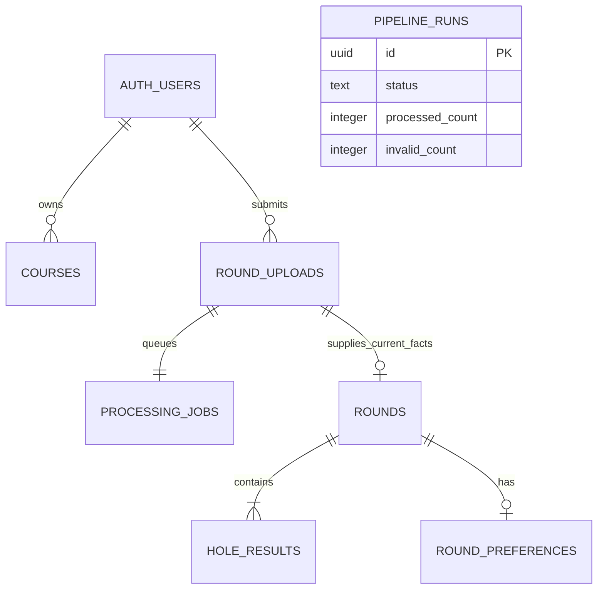

# Database schema

Approved and applied 19 November 2026.

One Supabase PostgreSQL database, seven application tables, and ordinary SQL views. Supabase manages accounts in `auth.users`; no separate profile table is needed.

## Shape

| Table | One row represents | Main writer |
| --- | --- | --- |
| `public.courses` | Current reusable course template | Owner, through validated course-save function |
| `public.round_uploads` | One immutable submitted round revision | Authenticated submission function |
| `private.processing_jobs` | Processing state for one upload | Submission function, then worker |
| `public.rounds` | Latest successfully cleaned version of one round | Python worker |
| `public.hole_results` | One selected hole in that clean round | Python worker |
| `public.round_preferences` | Star state for one processed round | Owner |
| `private.pipeline_runs` | One worker execution and its counts | Python worker |

The course ID in a round is a historical reference, without a foreign key to the editable course template. Course edits and archiving cannot alter a past round.

## 1. Course templates: `public.courses`

| Column | Type | Rule |
| --- | --- | --- |
| `user_id` | `uuid` | Required; account owner |
| `id` | `uuid` | Required; stable ID created on the phone |
| `revision` | `integer` | Required; positive, increasing per course |
| `document` | `jsonb` | Required; validated course document, at most 100 KB |
| `updated_at` | `timestamptz` | Required; server timestamp |

Primary key: `(user_id, id)`. The course-save function validates the complete document and saves it atomically. An identical retry is harmless; conflicting or older revisions are rejected. Course backup does not trigger the round pipeline.

The document contains:

| Field | Contents |
| --- | --- |
| `schema_version` | Document format version, initially `1` |
| `name`, `location` | Required name; optional short location text |
| `archived` | Boolean; hides an unused template without deleting snapshots |
| `distance_unit` | `yd` or `m` for course distances |
| `holes` | Nine or eighteen holes: number, par, stroke index |
| `tees` | Stable tee ID, name, and a positive distance for every hole |
| Each tee's `ratings` | Optional `full`, `front_nine`, and `back_nine` rating pairs |

A rating pair has nullable `course_rating` and `slope_rating`. Course rating uses a positive decimal with one decimal place. Slope uses an integer from 55 to 155, matching the [USGA definition](https://ncrdb.usga.org/NCRListing).

`full` refers to the complete nine- or eighteen-hole course template. Front/back rating pairs apply only to an eighteen-hole template. For a nine-hole round, use only the matching published nine-hole rating. Leave it unknown if unavailable; never halve an eighteen-hole rating. See [USGA nine-hole rating guidance](https://www.usga.org/content/usga/home-page/handicapping/roh/Content/rules/6%201b%209%20holes.htm).

Validation requires holes numbered exactly 1–9 or 1–18, unique stroke indexes from 1–18, pars from 3–6, unique tee IDs, nonblank names, and complete positive tee distances. For version 1, tees share hole pars and stroke indexes; distances and ratings vary by tee.

Keep course templates in JSON because the phone edits and restores each template as one document. Round analytics use typed snapshot columns below. Additional course/tee tables can wait until direct SQL queries of the course library justify them.

## 2. Raw submissions: `public.round_uploads`

| Column | Type | Rule |
| --- | --- | --- |
| `id` | `uuid` | Primary key; server receipt ID |
| `user_id` | `uuid` | Required; derived from authenticated session |
| `round_id` | `uuid` | Required; stable phone-created round ID |
| `revision` | `integer` | Required; positive, increasing per round |
| `payload_version` | `integer` | Required; supported submission format |
| `played_on` | `date` | Required; validated sorting metadata |
| `created_at` | `timestamptz` | Required; original round creation time |
| `payload` | `jsonb` | Required; complete submitted snapshot, at most 64 KiB |
| `received_at` | `timestamptz` | Required; server receipt time |

Unique `(user_id, round_id, revision)` prevents duplicate revisions. Unique `(user_id, id)` supports owner-matching foreign keys. An identical retry returns the original receipt; a changed payload cannot reuse a revision.

Validate envelope IDs, version, dates, and size before accepting an upload. Preserve the original creation time across corrections, enforced atomically during ingestion. The played date can be corrected through a new revision. Python then validates the full golf data. Invalid golf data retains its raw snapshot for diagnosis and correction.

Raw data contains original distances and units, course and selected-tee snapshots, selected holes, scores, optional observations, weather, and notes. Clients cannot update or delete accepted uploads. Raw history permits replay with a corrected transformation.

## 3. Clean rounds: `public.rounds`

All columns are required unless marked optional.

| Columns | Types | Purpose |
| --- | --- | --- |
| `user_id`, `id` | `uuid` | Owner and stable round ID; composite primary key |
| `source_upload_id` | `uuid` | Owner-matching foreign key to raw upload |
| `revision`, `transform_version` | `integer` | Submitted revision and cleaning-code version |
| `played_on`, `created_at`, `processed_at` | `date`, `timestamptz`, `timestamptz` | Play date, original creation time, server processing time |
| `round_type` | `text` | `casual`, `competition`, `tournament`, `practice` |
| `status`, `planned_holes` | `text`, `integer` | `completed` or `partial`; selected nine or eighteen holes |
| `course_id`, `course_name`, `course_location` | `uuid`, `text`, optional `text` | Frozen course identity and labels |
| `tee_id`, `tee_name` | `uuid`, `text` | Frozen selected tee identity and label |
| `distance_unit` | `text` | Original course/display unit: `yd` or `m` |
| `course_rating`, `slope_rating` | Optional `numeric`, optional `integer` | Ratings for the selected nine/eighteen holes |
| `weather`, `notes` | Optional `text` | Short weather note and round notes |

The submitted course includes its full `hole_count`; the tee includes its stable `id` and optional scoped `ratings`. Python selects `full` for a complete nine-hole course or eighteen-hole round, and `front_nine`/`back_nine` for nine holes of an eighteen-hole course. Snapshot ratings refer to the planned hole set, even when the round ends early. Missing matching ratings remain null. Ratings are stored for context; version 1 calculates gross scores without official handicap calculations.

One current clean row exists per round. A valid newer revision replaces round and hole facts in one transaction. An older arrival cannot overwrite a newer revision. Previous snapshots remain in raw uploads. If the newest submission is pending or invalid, app-facing views withhold older clean results rather than presenting them as current.

## 4. Clean hole facts: `public.hole_results`

| Columns | Types | Rule |
| --- | --- | --- |
| `user_id`, `round_id`, `number` | `uuid`, `uuid`, `integer` | Composite primary key; hole number 1–18 |
| `par`, `stroke_index`, `distance_m` | `integer`, `integer`, `numeric` | Required snapshot; positive distance in metres |
| `strokes` | Optional `integer` | Positive when played; null means unplayed |
| `putts`, `penalties` | Optional `integer` | Nonnegative; null means unrecorded |
| `mode` | `text` | Required: `zen`, `standard`, `detailed` |
| `tee_club`, `approach_club` | Optional `text` | Consistent club codes from an app picker |
| `tee_x`, `tee_y`, `approach_x`, `approach_y` | Optional `numeric` | Normalized selection coordinates from 0–1 |
| `tee_outcome`, `approach_outcome` | Optional `text` | Named result, listed below |
| `approach_distance_m` | Optional `numeric` | Nonnegative distance before the intended green-reaching shot |

Foreign key `(user_id, round_id)` references the matching clean round. Store all selected holes, including unplayed holes. Back-nine rounds use numbers 10–18. A complete round has scores for every selected hole; a partial round has at least one scored hole.

Rules:

- Strokes include putts and penalty strokes. Known putts plus known penalties cannot exceed strokes.
- Unplayed holes have no score statistics or shot observations. Their course snapshot and recording mode remain.
- Null means unknown; explicit zero remains zero. Zen mode does not fabricate zero putts or zero penalties.
- Coordinate pairs are both present or both absent. A named outcome can be recorded without a coordinate.
- Outcomes: `hit`, `left`, `right`, `short`, `long`, `short_left`, `short_right`, `long_left`, `long_right`.
- Coordinate orientation and outcome boundaries will be fixed with the accuracy-sheet design and tied to the submission/transform version.
- On par 3, one submitted tee observation also supplies the clean approach fields. Never count it twice as two physical shots. Fairway statistics exclude par 3.
- Preserve fields when switching modes. Mode describes the entry interface, not whether all its fields were recorded.
- Normalize distance using exactly 1 yard = 0.9144 metres. Do not infer approach distance from scorecard yardage.
- Normalize club aliases during cleaning; preserve the original label in raw data. No club catalog table is needed.

## 5. Stars: `public.round_preferences`

`user_id uuid`, `round_id uuid`, `starred boolean not null default false`.

Primary key `(user_id, round_id)`; foreign key to the matching clean round. Star changes do not create a new score revision. A star made before initial processing stays queued on the phone and syncs once clean facts exist. Unsynced preference changes must be protected from local trimming.

## 6. Job state: `private.processing_jobs`

`source_upload_id uuid` primary key, `user_id uuid`, `state text`, nullable `error_code text`, nullable `dispatch_requested_at timestamptz`, `updated_at timestamptz`.

One owner-matching foreign key to the raw upload. States: `pending`, `processed`, `invalid`. Upload and pending job are created in the same transaction. A transient worker failure rolls back and leaves work pending; invalid data receives a safe code and needs correction. Dispatch time throttles repeated workflow requests.

## 7. Run records: `private.pipeline_runs`

`id uuid` primary key; `started_at timestamptz`; nullable `finished_at timestamptz`; `transform_version integer`; `status text`; nonnegative `processed_count`, `invalid_count`, `skipped_count`; nullable `error_code text`.

States: `running`, `succeeded`, `failed`. Store small operational records, without payloads, notes, credentials, or stack traces. No separate issue table is needed for the first validation error on each upload.

## Views and data flow

The phone submits a frozen snapshot. Ingestion saves raw data and a job. The worker validates and writes clean facts. SQL views calculate results on demand; they do not store another copy of the data.

| View | Returns |
| --- | --- |
| `latest_round_status` | Latest submitted revision and processing state per round |
| `round_summaries` | Current score totals, score to par, recorded counts, and hit counts |
| `latest_twenty_rounds` | Current processed facts within the latest-twenty submitted-round window |
| `latest_twenty_metrics` | Rates and recorded/eligible denominators, separated by round length and partial status |
| `latest_twenty_shots` | Observed hole facts for club, distance, and directional breakdowns |

Choose the highest submitted revision for each round, order round identities by `played_on DESC`, original `created_at DESC`, and round ID, then select twenty. Receipt order cannot make a late-arriving older revision current. Only afterward include matching processed facts. New pending or invalid rounds occupy their slot; an older twenty-first round cannot fill it. Typed upload dates make this possible before clean facts exist. Older stars never expand the window.

The phone also knows about unsubmitted local rounds; its local window must include those IDs. Cloud views can rank only submitted rounds. Show analytical coverage while submissions are pending.

Do not store calculated totals or percentages as table columns. Known denominators accompany every rate. Approach hits are not greens in regulation. Separate nine/eighteen-hole and partial-round comparisons.

## Security and indexes

- Enable owner-scoped RLS on exposed tables and defense-in-depth RLS on private tables. Composite owner keys prevent cross-owner relationships.
- Disable anonymous access and public signup. Derive ownership from the verified session, never the payload.
- Allow the client to save courses through a validating function, submit rounds through ingestion, update its stars, and read its own data. Deny direct client writes to raw, clean, and processing tables.
- Use a restricted worker login without schema-management privileges or an RLS bypass. Keep processing tables outside exposed API schemas.
- Use `security_invoker = true` for app-facing views so underlying ownership rules apply, following [Supabase view security guidance](https://supabase.com/docs/guides/database/views#view-security).
- Keep primary/unique key indexes, an owner/date index for round ordering, owner-matching foreign-key indexes, and a partial index for pending jobs. Add no JSON search indexes without a query that needs them.
- Retain all submitted cloud history. Local phone trimming never deletes cloud rows.

## Changes

Apply future schema changes through a new migration, with matching submission, cleaning, and focused-test updates. Preserve raw snapshots when cleaning logic changes; `transform_version` identifies the code used for current facts.
